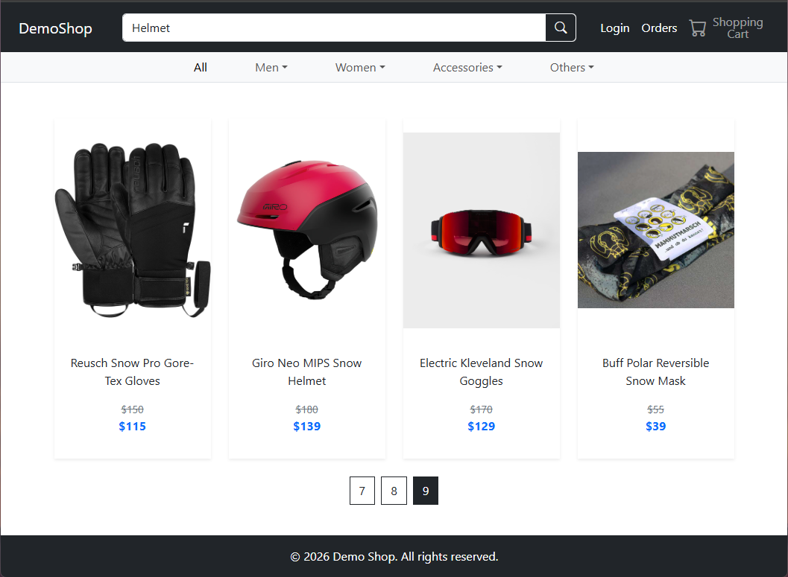
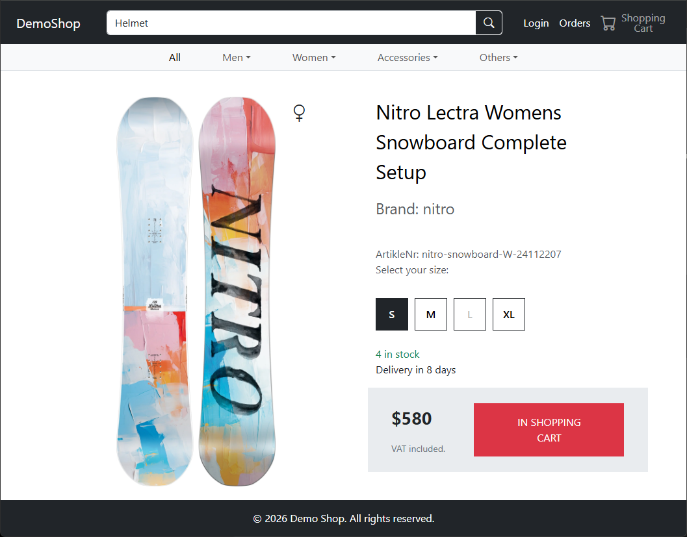
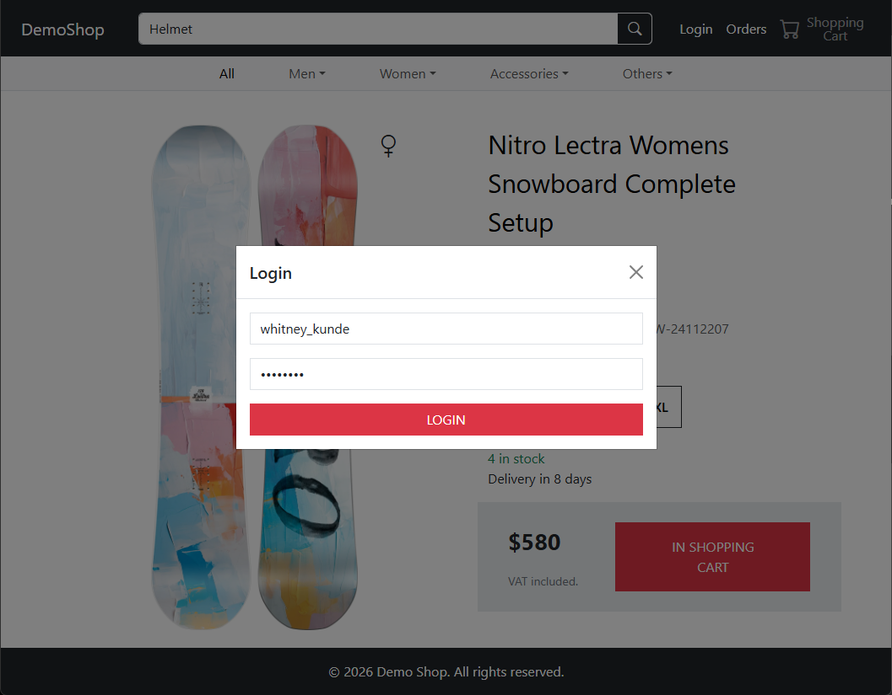
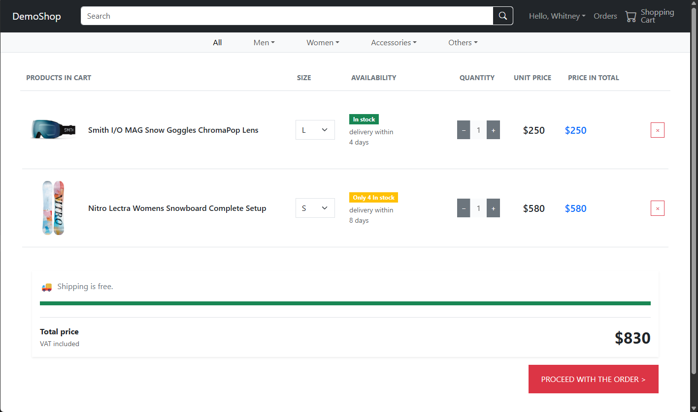
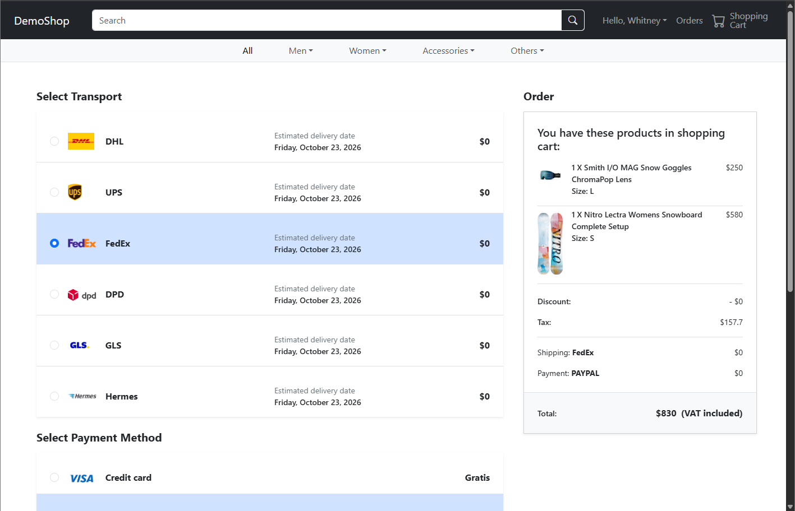
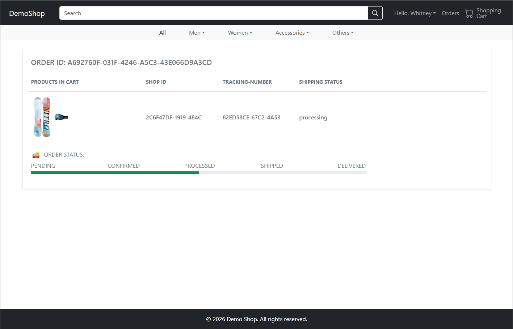
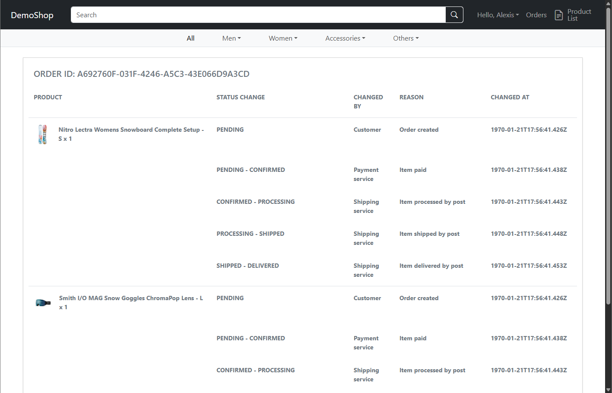
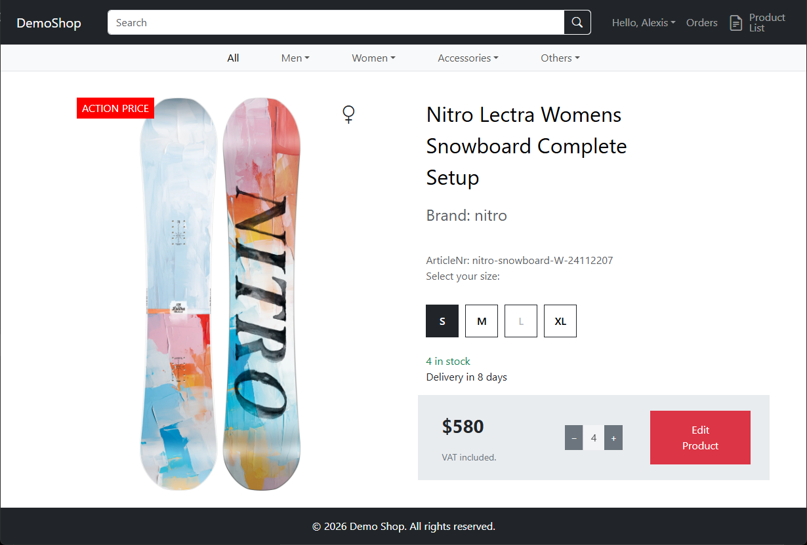
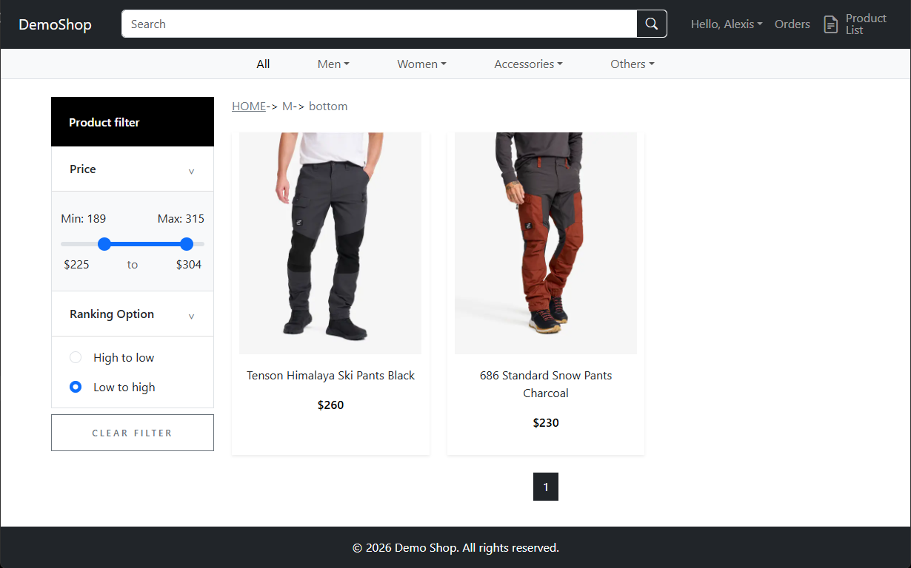

# Online Shop Frontend

A React-based frontend for an online shopping application. The application provides product browsing, product search, shopping cart functionality, order placement, and user-related interfaces.

## Features

- **Product browsing** — Browse products and view product details.
- **Product search** — Search for products using keywords.
- **Product filtering** — Display filtered product results.
- **Shopping cart** — View and manage items in the cart.
- **Order management** — Place orders and view order-related pages.
- **User interface** — Login, logout, and continue-related modals.
- **Payment interface** — Payment modal and payment-related UI.
- **Shop pages** — Separate product listing and product detail pages for the shop.
- **Routing** — Navigate between pages using React Router.
- **Cloud deployment workflow** — Includes a frontend build and an AWS S3 upload workflow(check out aws repository).

## Tech Stack

- React
- JavaScript (JSX)
- React Router
- CSS
- Bootstrap
- npm
- AWS S3 for frontend asset/build deployment

## Project Structure

```text
online-shop-frontend/
├── public/
├── src/
│   ├── api/
│   ├── assets/
│   ├── components/
│   │   ├── continue-modal.jsx
│   │   ├── filtered-product-grid.jsx
│   │   ├── footer.jsx
│   │   ├── login-modal.jsx
│   │   ├── logout-modal.jsx
│   │   ├── navbar.jsx
│   │   ├── navbar-secondary.jsx
│   │   ├── order.jsx
│   │   ├── payment-modal.jsx
│   │   ├── place-order.jsx
│   │   ├── product-card.jsx
│   │   ├── product-detail.jsx
│   │   ├── product-grid.jsx
│   │   ├── product-list.jsx
│   │   ├── product-shop-detail.jsx
│   │   ├── search-product-grid.jsx
│   │   ├── shop-order.jsx
│   │   └── shopping-cart.jsx
│   ├── data/
│   ├── layouts/
│   ├── styles/
│   ├── App.jsx
│   ├── App.css
│   ├── index.css
│   └── main.jsx
├── .gitignore
├── Dockerfile
├── eslint.config.js
├── index.html
├── LICENSE
├── package.json
├── package-lock.json
└── README.md
```

## Getting Started

### Prerequisites

Make sure you have installed:

- [Node.js](https://nodejs.org/)
- npm, which is included with Node.js

### Installation

Clone the repository and navigate to the project directory:

```bash
git clone <YOUR_REPOSITORY_URL>
cd online-shop-frontend
```

Install the dependencies:

```bash
npm install
```

### Run Locally

Check the `scripts` section in `package.json` for the available commands. If the project uses Vite, start the development server with:

```bash
npm run dev
```

If the project uses Create React App, the command is usually:

```bash
npm start
```

Open the local URL displayed in your terminal.

## Application Pages

The current routing configuration in `App.jsx` includes the following routes:

| Route | Purpose |
|---|---|
| `/` | Product grid |
| `/*` | Filtered product grid fallback |
| `/search/:keyword` | Search results |
| `/all` | All products |
| `/products/:id` | Product details |
| `/cart` | Shopping cart |
| `/place-order` | Order placement |
| `/order` | Order page |
| `/shop-order` | Shop order page |
| `/shop/product-list` | Shop product listing |
| `/shop/products/:id` | Shop product details |

Routes and page behavior may depend on the application's authentication state and other components.

## Backend Integration

The frontend contains an `src/api/` directory for API-related code.

If the application communicates with a backend, configure the API base URL and any required authentication settings according to your environment.

For local development, document the required backend services and their startup instructions here.

**Configuration checklist:**
- Backend API URL
- Authentication and session handling
- Required environment variables
- CORS configuration, if applicable

## Deployment

### Kubernetes

1. Run Dockerfile to build image:
```bash
docker build -t MY_TAG:MY_VERSION .
```

2. Configure deployment file for frontend. View k8s repository for more details.

### AWS S3

For an S3 deployment, the general workflow is:

1. Build dist output directory by:
```bash
npm run build
```
2. Upload the generated dist to the configured S3 bucket by:
```bash
aws s3 sync .\dist\ s3://portshop-bucket/frontend --delete
```

The option --delete removes files that no longer exist in local dist folder.

3. Configure CloudFront and Loadbalancer if they do not exist. View aws repository for more details.


## Screenshots

### Home Page



### Product Details



### Login



### Shopping Cart



### Placing Order



### Order Details



### Shop Order View



### Shop Product View



### Product Filter



## License

This project is licensed under the terms described in the [LICENSE](LICENSE) file.
